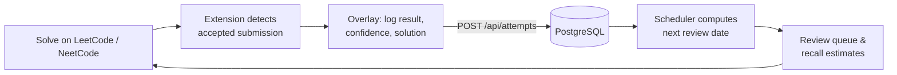
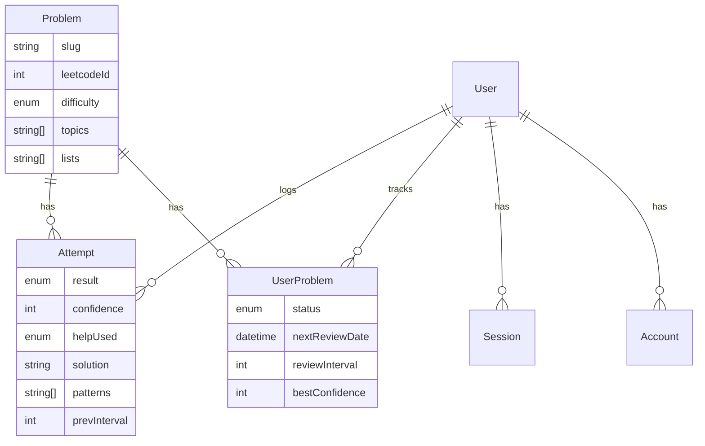

<div align="center">


# LeetPro

**Know which problems you're about to forget.**

A spaced-repetition ledger for LeetCode and NeetCode practice. A Chrome extension logs every problem you solve; the web app estimates how well you still remember each one and brings it back right before it slips.

[](https://nextjs.org)
[](https://react.dev)
[](https://www.typescriptlang.org)
[](https://tailwindcss.com)
[](https://www.prisma.io)
[](https://www.postgresql.org)
[](https://www.better-auth.com)
[](https://developer.chrome.com/docs/extensions/develop/migrate/what-is-mv3)
[](https://pnpm.io)

</div>

---

## Contents

- [Features](#features)
- [How it works](#how-it-works)
- [Tech stack](#tech-stack)
- [Project structure](#project-structure)
- [Getting started](#getting-started)
- [Chrome extension](#chrome-extension)
- [Environment variables](#environment-variables)
- [Scripts](#scripts)
- [API reference](#api-reference)
- [Data model](#data-model)
- [Deployment](#deployment)
- [Design system](#design-system)
- [Contributing](#contributing)

## Features

- **Automatic capture.** The extension detects accepted submissions on `leetcode.com` and `neetcode.io` and opens an in-page overlay to log the attempt: result, confidence (1–5), time, help used, approach, patterns, notes, and the full solution with its language.
- **Spaced-repetition scheduling.** Each attempt reschedules the problem. Intervals grow with confidence (1 → 3 → 7 → 14 days, then doubling up to 180) and reset when you struggle.
- **Recall estimates.** An exponential forgetting curve shows how well you probably still remember every problem, so fading ones stand out before they're due.
- **Review queue.** One page of what's due today, ordered by urgency.
- **Curated lists.** Track progress through Blind 75, Grind 75, and NeetCode 150.
- **Dashboard.** Totals, difficulty and status breakdowns, streaks, and per-topic progress.
- **Editable history.** Edit any past attempt; the schedule is recomputed from a snapshot taken before that attempt.
- **Extension popup stats.** See per-problem history right from the toolbar while you're on a problem page.
- **Sign-in options.** Email and password, or Google, GitHub, and Discord OAuth.

## How it works



### Scheduling

Implemented in [`src/lib/spaced-repetition.ts`](src/lib/spaced-repetition.ts).

| Confidence | Base interval | Resulting status |
| :--------: | :------------ | :--------------- |
| 1–2 | 1 day (always resets) | `learning` |
| 3 | 3 days | `review` |
| 4 | 7 days, or 2× current interval | `review` |
| 5 | 14 days, or 2× current interval | `review`, then `mastered` once the interval reaches 14+ days |

Intervals cap at **180 days**.

### Recall estimate

Implemented in [`src/lib/recall.ts`](src/lib/recall.ts). LeetPro models memory as

$$R(t) = e^{-t/S}$$

where `t` is days since the last attempt and `S` is set so recall falls to **70%** exactly on the scheduled review date. Problems below 70% are marked as fading. The estimate is for display only and does not feed the scheduler.

## Tech stack

| Layer | Tools |
| :---- | :---- |
| Framework | [Next.js 16](https://nextjs.org) (App Router, Turbopack), [React 19](https://react.dev) |
| Language | [TypeScript 5](https://www.typescriptlang.org) |
| Styling | [Tailwind CSS 4](https://tailwindcss.com), [shadcn/ui](https://ui.shadcn.com) on [Base UI](https://base-ui.com), [tw-animate-css](https://github.com/Wombosvideo/tw-animate-css), [Lucide](https://lucide.dev) icons |
| Database | [PostgreSQL 16](https://www.postgresql.org) |
| ORM | [Prisma 7](https://www.prisma.io) with the [`@prisma/adapter-pg`](https://www.prisma.io/docs/orm/overview/databases/postgresql) driver adapter |
| Auth | [Better Auth](https://www.better-auth.com) (email/password, Google, GitHub, Discord) |
| Validation | [Zod 4](https://zod.dev) |
| Dates | [date-fns 4](https://date-fns.org) |
| Extension | Chrome Manifest V3, plain JavaScript (service worker, content scripts, popup) |
| Tooling | [pnpm](https://pnpm.io), [ESLint 9](https://eslint.org), [tsx](https://tsx.is), [Docker Compose](https://docs.docker.com/compose/) |

## Project structure

```text
leetpro/
├── brand/                    # Logo source files (SVG)
├── extension/                # Chrome extension (Manifest V3)
│   ├── background/           # Service worker: auth + API calls
│   ├── content/              # LeetCode / NeetCode detectors, overlay, page bridge
│   ├── icons/                # Toolbar icons (active + grey states)
│   └── popup/                # Toolbar popup UI
├── prisma/
│   ├── migrations/           # SQL migrations
│   ├── schema.prisma         # Data model
│   └── seed.ts               # Seeds Blind 75, Grind 75, NeetCode 150
├── src/
│   ├── app/
│   │   ├── (app)/            # Authenticated pages: dashboard, problems, review, lists
│   │   ├── (auth)/           # Sign-in / sign-up
│   │   └── api/              # Route handlers (attempts, problems, review, stats, auth)
│   ├── components/           # App components + shadcn/ui primitives in ui/
│   ├── lib/                  # Auth, Prisma client, scheduler, recall model, validation
│   │   └── data/             # Problem lists and topics
│   └── proxy.ts              # Route protection (Next.js 16 proxy)
├── DESIGN.md                 # Design system
├── prisma7.config.ts         # Prisma config (schema, migrations, datasource)
└── docker-compose.yml        # Local PostgreSQL
```

## Getting started

### Prerequisites

- [Node.js](https://nodejs.org) 20 or later
- [pnpm](https://pnpm.io/installation) 10 (`corepack enable` picks up the pinned version)
- [Docker](https://www.docker.com) for the local database, or any PostgreSQL 16 instance
- Google Chrome or another Chromium browser for the extension

### 1. Clone and install

```bash
git clone git@github.com:asallh/leetpro.git
```

```bash
cd leetpro && pnpm install
```

### 2. Configure the environment

```bash
cp .env.example .env
```

Generate an auth secret and paste it into `BETTER_AUTH_SECRET`:

```bash
openssl rand -base64 32
```

OAuth credentials are optional for local development; email and password sign-in works without them.

### 3. Start PostgreSQL

```bash
docker compose up -d
```

The defaults in `.env.example` match `docker-compose.yml`.

### 4. Set up the database

```bash
pnpm db:migrate
```

```bash
pnpm db:generate
```

```bash
pnpm db:seed
```

The seed loads every problem from Blind 75, Grind 75, and NeetCode 150.

### 5. Run the app

```bash
pnpm dev
```

Open [http://localhost:3000](http://localhost:3000) and create an account.

## Chrome extension

The extension lives in [`extension/`](extension/) and needs no build step.

1. Open `chrome://extensions` and turn on **Developer mode**.
2. Click **Load unpacked** and select the `extension/` folder.
3. Pin LeetPro to the toolbar and sign in from the popup.
4. Solve a problem on LeetCode or NeetCode. When the submission is accepted, the overlay opens so you can log it.

The extension talks to `http://localhost:3000` by default. The API base URL is stored in `chrome.storage.local` under `leetpro_api_base`, so it can point at a deployed instance. When pointing it at production, add that origin to `host_permissions` in [`manifest.json`](extension/manifest.json).

> [!IMPORTANT]
> In production the auth API rejects every `chrome-extension://` origin unless its ID is listed in `LEETPRO_EXTENSION_IDS`. Copy the ID from `chrome://extensions`.

## Environment variables

| Variable | Required | Description |
| :------- | :------: | :---------- |
| `DATABASE_URL` | Yes | PostgreSQL connection string |
| `BETTER_AUTH_SECRET` | Yes | Secret used to sign sessions (`openssl rand -base64 32`) |
| `BETTER_AUTH_URL` | Yes | Public base URL of the app |
| `NEXT_PUBLIC_APP_URL` | Yes | Base URL exposed to the client |
| `LEETPRO_EXTENSION_IDS` | Production | Comma-separated Chrome extension IDs allowed to call the auth API. Development allows any extension when unset |
| `GOOGLE_CLIENT_ID` / `GOOGLE_CLIENT_SECRET` | No | Google OAuth |
| `GITHUB_CLIENT_ID` / `GITHUB_CLIENT_SECRET` | No | GitHub OAuth |
| `DISCORD_CLIENT_ID` / `DISCORD_CLIENT_SECRET` | No | Discord OAuth |

OAuth callback URLs follow Better Auth's pattern: `{BETTER_AUTH_URL}/api/auth/callback/{provider}`.

## Scripts

| Command | Description |
| :------ | :---------- |
| `pnpm dev` | Start the dev server |
| `pnpm build` | Production build |
| `pnpm start` | Serve the production build |
| `pnpm lint` | Run ESLint |
| `pnpm db:migrate` | Create and apply migrations (development) |
| `pnpm db:generate` | Generate the Prisma client into `src/generated/prisma` |
| `pnpm db:seed` | Seed problem lists |
| `pnpm db:studio` | Open Prisma Studio |

## API reference

Every endpoint except `/api/auth/*` requires an authenticated session.

| Method | Endpoint | Description |
| :----- | :------- | :---------- |
| `GET` | `/api/problems` | List problems with the user's progress |
| `GET` | `/api/problems/stats?slug=` | Attempt history and stats for one problem |
| `POST` | `/api/problems/detect` | Find or create a problem from its slug and platform; used by the extension |
| `GET` | `/api/attempts` | List the user's attempts |
| `POST` | `/api/attempts` | Log an attempt and reschedule the problem |
| `PATCH` | `/api/attempts/:id` | Edit an attempt and recompute its schedule |
| `GET` | `/api/review` | Problems due for review |
| `GET` | `/api/stats` | Dashboard metrics |
| `*` | `/api/auth/*` | Better Auth handlers |

Request bodies are validated with Zod schemas in [`src/lib/validations.ts`](src/lib/validations.ts).

## Data model



`User`, `Session`, `Account`, and `Verification` are managed by Better Auth. The full schema is in [`prisma/schema.prisma`](prisma/schema.prisma).

## Deployment

LeetPro is a standard Next.js app and runs on any Node host (Vercel, Railway, Fly.io, a container) with a managed PostgreSQL database.

1. Provision PostgreSQL and set `DATABASE_URL`.
2. Set `BETTER_AUTH_SECRET`, `BETTER_AUTH_URL`, `NEXT_PUBLIC_APP_URL`, and `LEETPRO_EXTENSION_IDS`.
3. Apply migrations during release:

   ```bash
   pnpm prisma migrate deploy
   ```

4. Build and start:

   ```bash
   pnpm build && pnpm start
   ```

5. Seed once with `pnpm db:seed`.
6. Register each OAuth provider's callback URL against the production domain.

## Design system

The interface is a dark, terminal-adjacent ledger: graphite surfaces, warm ink, and a single amber signal for what's due. Headings use **JetBrains Mono** and body text uses **Hanken Grotesk**. Tokens, components, and rules are in [`DESIGN.md`](DESIGN.md); please read it before UI work.

The logo is three ledger entries fading top to bottom, with the amber one due. The source of truth is [`brand/leetpro-mark.svg`](brand/leetpro-mark.svg).

## Contributing

1. Branch from `development`.
2. Keep changes focused, and run `pnpm lint` and `pnpm build` before opening a pull request.
3. If you change the schema, include the migration (`pnpm db:migrate --name <change>`).
4. Open a pull request against `main`.

> [!NOTE]
> This project uses Next.js 16, which has breaking changes from earlier versions (for example, `middleware.ts` is now `proxy.ts`). See [`AGENTS.md`](AGENTS.md).

---

<div align="center">
<sub>Built for people grinding interviews who'd rather not relearn Two Sum every month.</sub>
</div>
